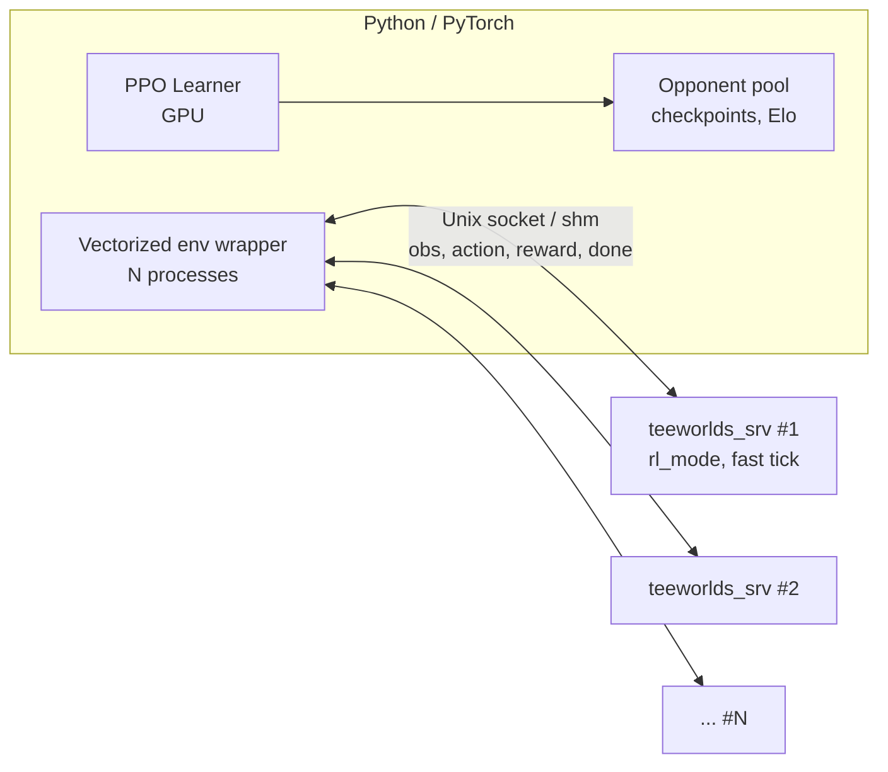

# Teeworlds RL Self-Play: Analysis and Architecture Proposal

> **Status: development is paused (as of 2026-11-02) and can be resumed at any time.**
> Phases 0-2 are on `main`. The latest work, Phase 3 (PPO training), lives on the [`phase3`](../../tree/phase3) branch.
> To continue from where it stopped, check out `phase3` and read the "Where we are" and "Where we stopped and next step" sections of `HANDOFF.md`.
> Turkish originals of the docs are in [`tr/`](tr/). Details about removed personal/server information: [SANITIZATION.md](SANITIZATION.md).

Date: 2026-10-18. Status: analysis only, no code changes.

Goal: two AIs learn aim, movement, dodging and combat through self-play in 1v1 Deathmatch.

## Core decisions (2026-10-19)

- No strategy is coded into the AI. Only observation, action and reward are defined; it learns how to play from experience.
- The first model starts from random weights. No behavior cloning (imitating human play).
- The main reward is kill/death. Damage dealt/taken may be a small auxiliary reward. Suicide may carry a larger penalty.
- At the start there is no proximity (approaching the opponent) reward and no aim (correct targeting) reward. This reduces the risk of reward hacking.
- A simple rule-based bot is not a required starting point for training. It may be added later as a baseline/evaluation opponent or a curriculum experiment.
- Self-play later uses an opponent pool: current, champion, old checkpoints, baseline.

> Note: Line numbers and findings come from sub-agent reports and do not match tag `0.7.5` (commit `4fc25a1`) exactly. Examples: tick loop `server.cpp:1425`, `FireWeapon` `character.cpp:252`, fixed network wait `m_NetServer.Wait(5)` (`server.cpp:1490`). `SERVER_TICK_SPEED=50` is in `engine/shared/protocol.h:81`. The server calls `srand(time_get())` inside `CEngine` (`engine/shared/engine.cpp:53`). Verify every reference in the source before writing code. Paths are under `teeworlds/src/`.

---

## Part 1. Teeworlds 0.7.5 server analysis

Version: `game/version.h` → GAME_VERSION "0.7.5". `src/generated/*` is produced at build time from `datasrc/network.py` and `datasrc/content.py`; it is absent right now. The base game-mode class is `IGameController` (not `CGameController`). `CWeaponStat` does not exist; `CCharacter::WeaponStat` is used instead.

### 1. Server game loop
- `engine/server/server.cpp`: `main` (1809) → `CServer::Run` (~1270-1390).
- Tick loop: `while(Now > TickStartTime(m_CurrentGameTick+1))` (1383). Each pass does `m_CurrentGameTick++`, applies queued inputs via `GameServer()->OnClientPredictedInput`, then `GameServer()->OnTick()`.
- `DoSnapshot()` runs every 2nd tick, followed by `PumpNetwork()` and `m_NetServer.Wait()`.
- `CGameContext::OnTick` (`game/server/gamecontext.cpp:538`): `m_World.Tick()`, `m_pController->Tick()`, `CPlayer::Tick/PostTick`, voting.
- `CGameWorld::Tick` (`gameworld.cpp:166`): order is projectile, laser, pickup, character, flag, then `TickDefered()`.
- `IGameController::Tick` (`gamecontroller.cpp:740`): warmup/countdown/running/end, win check.

### 2. Player/Character
- `CPlayer` (`game/server/player.h/.cpp`): `m_Score`, `m_Dummy`, `m_Team`, `m_pCharacter`, `m_RespawnTick`, `m_DieTick`. Constructor at `player.cpp:15`.
- `CCharacter` (`game/server/entities/character.h/.cpp`): `m_Input`, `m_LatestInput`, `m_LatestPrevInput`, health/armor, `m_aWeapons[]`, `m_Core`.
- `CCharacterCore`, `CWorldCore`: `game/gamecore.h/.cpp`.
- `PLAYERFLAG_BOT` is defined in the protocol (`datasrc/network.py:9`).

### 3. Movement input
- `CNetObj_PlayerInput` (`datasrc/network.py:88`): `m_Direction` (-1..1), `m_TargetX/Y`, `m_Jump`, `m_Fire` (counter), `m_Hook`, `m_WantedWeapon`, `m_NextWeapon`, `m_PrevWeapon`.
- Flow: `CGameContext::OnClientPredictedInput` (`gamecontext.cpp:657`) → `CPlayer::OnPredictedInput` (`player.cpp:225`) → `CCharacter::OnPredictedInput` (`character.cpp:480`) → `CCharacter::Tick` (525, `m_Core.Tick(true)`) → `TickDefered` (540, `Move`, `Quantize`).
- Physics: `CCharacterCore::Tick` (`game/gamecore.cpp:90`): jump 114-133, hook state machine 136-300.
- Parameters: `game/tuning.h` (`CTuningParams`). Collision: `CCollision` (`game/collision.cpp`): `IntersectLine`, `MoveBox`, `TestBox`.

### 4. Aim
- `m_TargetX/Y` is a vector relative to the player. It is normalized on fire (`character.cpp:253`) and on hook (`gamecore.cpp:99,142`). (0,0) → (0,-1) (`character.cpp:489,499`).

### 5. Fire
- `CCharacter::FireWeapon` (`character.cpp:248`), `HandleWeapons` (409), `HandleNinja` (117).
- `m_Fire` is a counter; presses are counted with `CountInput` (line 21).
- Entities: `entities/projectile.cpp`, `laser.cpp`, `pickup.cpp`, `flag.cpp`.
- **Important:** `FireWeapon` reads `m_LatestInput`. Only `OnDirectInput` (`character.cpp:495`) fills this field. A bot that fires must also call `OnDirectInput`.

### 6. Weapon system
- Stats live in `datasrc/content.py` (`WeaponSpec` 72, examples 627-677).
- `CCharacter::WeaponStat` (`character.h:76`), `m_aWeapons[NUM_WEAPONS]` (82).
- `DoWeaponSwitch` (197), `HandleWeaponSwitch` (207), `GiveWeapon` (451), `GiveNinja` (462), `SetWeapon` (92).
- Pickups: `IGameController::OnEntity` (`gamecontroller.cpp:261`), indices in `game/mapitems.h:32-59`.

### 7. Damage/Death
- `CCharacter::TakeDamage` (`character.cpp:714`): armor absorbs first, self-damage is halved, `IsFriendlyFire` (`gamecontroller.cpp:854`).
- `CCharacter::Die` (657), `IGameController::OnCharacterDeath` (`gamecontroller.cpp:218`).
- `CGameContext::CreateExplosion` (`gamecontext.cpp:126`).

### 8. Spawn
- `CPlayer::Tick` (`player.cpp:45`): `Respawn()` 3 seconds after death. `CPlayer::TryRespawn` (462) → `IGameController::CanSpawn` (`gamecontroller.cpp:999`).
- `EvaluateSpawnPos` (1032) picks the point farthest from the enemy. Survival modes pick randomly (1075).
- `OnCharacterSpawn` (247): health and weapons.

### 9. Deathmatch scoring
- `OnCharacterDeath` (218): +1 for the killer, -1 for suicide.
- `DoWincheckMatch` (415): in DM the highest `m_Score` wins (441-453). Score and time limit.
- `ResetGame` (467), `StartMatch` (629), `SetGameState` (482).
- `gamemodes/dm.cpp` is an empty subclass that only sets the game type name. Mode selection happens in `CGameContext::OnInit` (`gamecontext.cpp:1598`), via `sv_gametype`.

### 10. Tick system
- 50 Hz tick, 25 Hz snapshot.
- `CServer::TickStartTime` (`server.cpp:330`): computed from `time_get()`. The only sleep is `m_NetServer.Wait(1-10 ms)`. If the server falls behind, it catches up several ticks at once.

### 11. Bot/AI integration points
- Debug-build-only dummy support: `dbg_dummies` (`game/variables.h:148`), `OnInit` (`gamecontext.cpp:1666-1676`) `OnClientConnected(MAX_CLIENTS-i-1, true, false)`, fake input inside `OnTick` (625-635). Disabled by `#ifdef CONF_DEBUG`, does not work in Release.
- Cleanest injection: inside `OnTick`, before `m_World.Tick()`, call `m_apPlayers[cid]->OnPredictedInput(&in)` and `OnDirectInput(&in)`.
- Fake client: `CGameContext::OnClientConnected(id, true, false)` (`gamecontext.cpp:747`). `IsClientBot` (1717).
- Observation sources: `GetCharacter()->GetPos()`, `m_Core.m_Vel`, `m_Core.m_HookState/HookPos/HookedPlayer`, `m_Health`, `m_Armor`, `m_aWeapons[].m_Ammo`, `m_ActiveWeapon`, `m_World.FindFirst(ENTTYPE_*)`, `FindEntities` (`gameworld.cpp:46`), `Collision()->IntersectLine`, `m_apPlayers[i]->m_Score`.

### 12. Headless and fast simulation
- The server is a separate target (`teeworlds_srv`, `CMakeLists.txt:90`). It needs no SDL, graphics or audio.
- Speed limiters: the `time_get()` gate in `Run` and `Wait`. Fix: an RL mode that skips the time check and the sleep, or a fake clock.
- Determinism: physics uses no RNG. `srand(time_get())` (`engine/shared/engine.cpp:53`) and `random_int/float` (team selection, survival spawn) can be reproduced with a fixed seed.
- Embedding the game logic in-process requires stubbing `IServer` and `IMap`. Patching the server is far less work.
- Reusable for a Python simulator: `game/gamecore.cpp/.h`, `game/collision.cpp`, `game/tuning.h`. Combat logic (projectiles, damage, spawn) lives only in `game/server`.

---

## Part 2. tmlp (timakro/tmlp) analysis

Sources: `a2c.py`, `old_nn.py`, `render_video.py`, the README, and the C++ side in the `timakro/teeworlds-tmlp` submodule (read through the raw API, not cloned).

| Topic | tmlp |
|---|---|
| Connection | Python starts the server as a subprocess (`a2c.py:179`). No sockets. Bots are dummy clients inside the server via `dbg_dummies`. |
| Sync | Python sends `SIGUSR1`. The server waits with `pause()` in the tick loop (`HandleResumeSignal`, `gamecontext.cpp`). |
| Data flow | The server writes `rollouts/<srv>-<bot>-state.gz` and `-action.gz`. Python reads the gzips, writes a TF SavedModel into `savedmodel/`, and the server loads it. |
| Policy location | TensorFlow C++ inside the server (`model.cpp`, `CModel`). Python only trains. |
| Observation | Agent-centered 90×50 `uint8` tile grid. `collision.cpp::RenderTMLPFrame` renders the static map, `gameworld.cpp::RenderTMLPFrame` the dynamic entities. 3 HUD cells (health, armor, ammo). 22-value vocabulary. No velocity and no exact position. |
| Action | Mixed: continuous aim (Gaussian x/y), 5 Bernoulli (left, right, jump, fire, hook), 5-class weapon softmax. Fire is applied as an increasing counter. |
| Control | `HandleTMLP()` every 2nd tick (~25 Hz): write reward, render grid, `ForwardPass`, `BotSampleAction`, `OnPredictedInput` + `OnDirectInput`. |
| Reset | Instant respawn within an episode (`tmlp_training_mode=1`). At episode boundaries Python kills and restarts all server processes (`a2c.py:237-239`). Map and pickup state are not reset within an episode. |
| Parallelism | `SERVER_AGENTS = [2]*35`: 35 processes × 2 bots = 70 agents. |
| Base version | Teeworlds **0.6** (our code is 0.7.5; the patch does not port directly). |

### C++ changes
- New: `model.cpp/h`, `rolloutsaver.cpp/h`.
- `variables.h`: 6 new `tmlp_*` settings.
- `gamecontext.cpp/h`: `HandleTMLP`, signal handler.
- `player.cpp/h`: `m_IsBot`, RNN state, reward, instant respawn.
- `character.cpp/h`: `BotRenderFrame`, `BotSampleAction`, reward hooks inside `TakeDamage` (damage × 0.2, kill +10, suicide -10).
- `gameworld`, `collision`, `projectile/laser/pickup.h`: access for rendering.
- `server.cpp`, `system.c`, `CMakeLists.txt` (TF C++ dependency): small changes, scope not verified.

### Algorithm
- A2C + GAE, TF 1.14. γ=0.99, λ=0.95, LR=1e-4, `MAX_GRAD_NORM=40`.
- Network: `Embedding(22,8)`, 3× Conv2D, `LSTM(512)`, 5 output heads.
- One gradient step per 625-step chunk.
- `old_nn.py`: the project first started with behavior cloning from human play.

### Why it did not work well

**What the author says in the README:**
- It is unclear whether the A2C and RNN training loop is set up correctly.
- No hyperparameter sweep.
- The input and action representation may be insufficient.
- There may be a bug.
- RL may not work on this problem at all.

**Inferred from the code (the author did not say this):**
- Sparse reward (kill +10, suicide -10, damage 0.2).
- A single gradient step; no multi-epoch updates like PPO.
- `MAX_GRAD_NORM=40` (the code's own comment suggests 1–10).
- No velocity in the observation.
- The world is not reset within an episode.
- Blocking the tick loop with `pause()` and gzip file IPC.
- Bugs: no `volatile sig_atomic_t` for `m_WaitingForSignal`, an uninitialized variable in `SampleClass`.

The main cause is most likely the combination of reward sparsity and raw visual observation. There is no proof; an experiment must separate them.

### Reuse

**Taken as ideas:**
- Dummy clients inside the server and `OnPredictedInput` + `OnDirectInput` injection.
- Instant-respawn mode, reward hooks in `TakeDamage`/`Die`.
- N processes × K agents parallelism.
- Mixed action space (including the fire counter).

**Redesigned completely:**
- IPC: a binary protocol (Unix socket, later shared memory) instead of signals and files.
- The policy stays in Python/GPU; the server is only a simulator.
- PPO (PyTorch), multiple epochs, grad norm 0.5–1.
- Observation: vector features (velocity, hook, exact position, relative opponent) in addition to the tile grid.
- Reset: in-process `ResetGame` instead of restarting processes.
- Time: remove the `time_get` gate and speed up ticks (tmlp stays at real-time 50 Hz).
- Self-play: opponent pool and gradual difficulty.
- The behavior-cloning warm-up is not adopted: the model starts from random weights.
- Code base: a clean patch on 0.7.5 instead of 0.6.

---

## Part 3. Proposed architecture

1. **Server patch (0.7.5):**
   - `sv_rl_mode`: the time gate and `Wait` in `CServer::Run` are skipped; snapshots and network writes are turned off.
   - `IRLBridge` interface: writes an observation and reads an action every K ticks.
   - Both agents are dummy clients. Input is delivered through `OnPredictedInput` + `OnDirectInput`.
   - `ResetEpisode()`: `ResetGame` resets score, characters, pickups and projectiles with a fixed seed. The process does not restart.
2. **Bridge:** a multi-agent Gymnasium/PettingZoo-style environment in Python. One process = two agents = one env. `step(actions) → obs, reward, done`.
3. **Observation:**
   - vector: own velocity/position/health/armor/weapon/ammo/hook, opponent relative position and velocity, nearby projectiles
   - grid: a small agent-centered tile map (e.g. 41×25), processed by a CNN
4. **Action:** movement (3), jump, hook, fire, weapon (5), aim angle (discrete, 32–64 bins). A continuous Gaussian can be tried later.
5. **Reward:** kill/death is the main reward; damage dealt is a small positive and damage taken a small negative auxiliary reward; suicide is a larger negative. No proximity or aim reward. Not strictly zero-sum: kill/death and (with the same coefficient) damage dealt/taken are symmetric between the two agents, but suicide and self-damage affect only one side.
6. **Model:** small CNN + MLP + optional GRU. PPO, GAE, adaptive entropy.
7. **Self-play:** two agents starting from random weights play each other; later, sample from a checkpoint pool (80% latest, 20% older). A rule-based bot is not required; use it only as a baseline/evaluation or curriculum experiment if needed.
8. **Phases:**
   - Phase 0: speed measurement (tick gate patch, ticks/s).
   - Phase 1: bridge and Python env, end-to-end validation with a random policy.
   - Phase 2: single weapon, small map, two-agent self-play PPO.
   - Phase 3: full map, self-play, weapons and pickups.
   - Phase 4: spectator mode with a human client.

**Critical risk:** ticks/s in Phase 0. If the number is low (e.g. <2000 ticks/s per process), rewriting the physics in Python or building a light C++ simulator around `gamecore` only must be considered. Do not lock the architecture before measuring.

**Next step:** a file-level plan for Phase 0 and Phase 1.

---

Other files: [PLAN.md](PLAN.md) (phase plan and acceptance criteria), [HANDOFF.md](HANDOFF.md) (continuing in a new session).
