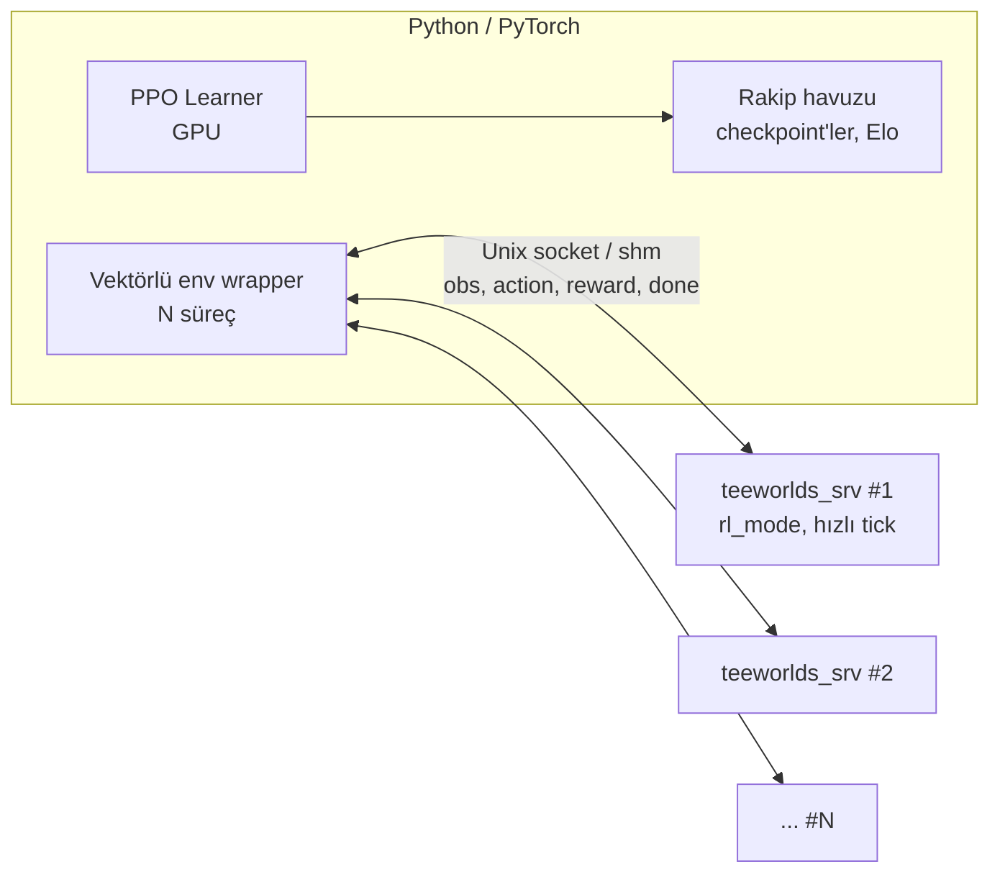

# Teeworlds RL Self-Play: Analiz ve Mimari Önerisi

Tarih: 2026-10-18. Durum: yalnızca analiz, kod değişikliği yok.

Hedef: iki AI'ın 1v1 Deathmatch'te self-play ile aim, movement, dodge ve combat öğrenmesi.

> Not: Satır numaraları ve bulgular alt ajan raporlarından alındı. Tek tek doğrulanmadı. `SERVER_TICK_SPEED` tanımının yeri doğrulanmadı (değeri 50 Hz). Yollar `teeworlds/src/` altındadır.

---

## Bölüm 1. Teeworlds 0.7.5 server analizi

Sürüm: `game/version.h` → GAME_VERSION "0.7.5". `src/generated/*` build sırasında `datasrc/network.py` ve `datasrc/content.py`'den üretilir, şu an yok. Taban oyun modu sınıfı `IGameController` (`CGameController` değil). `CWeaponStat` yok, onun yerine `CCharacter::WeaponStat`.

### 1. Server game loop
- `engine/server/server.cpp`: `main` (1809) → `CServer::Run` (~1270-1390).
- Tick döngüsü: `while(Now > TickStartTime(m_CurrentGameTick+1))` (1383). Her turda `m_CurrentGameTick++`, kuyruktaki girdileri `GameServer()->OnClientPredictedInput` ile uygula, `GameServer()->OnTick()`.
- `DoSnapshot()` her 2. tick'te, ardından `PumpNetwork()` ve `m_NetServer.Wait()`.
- `CGameContext::OnTick` (`game/server/gamecontext.cpp:538`): `m_World.Tick()`, `m_pController->Tick()`, `CPlayer::Tick/PostTick`, oylama.
- `CGameWorld::Tick` (`gameworld.cpp:166`): projectile, laser, pickup, character, flag sırası, sonra `TickDefered()`.
- `IGameController::Tick` (`gamecontroller.cpp:740`): warmup/countdown/running/end, kazanma kontrolü.

### 2. Player/Character
- `CPlayer` (`game/server/player.h/.cpp`): `m_Score`, `m_Dummy`, `m_Team`, `m_pCharacter`, `m_RespawnTick`, `m_DieTick`. Constructor `player.cpp:15`.
- `CCharacter` (`game/server/entities/character.h/.cpp`): `m_Input`, `m_LatestInput`, `m_LatestPrevInput`, sağlık/zırh, `m_aWeapons[]`, `m_Core`.
- `CCharacterCore`, `CWorldCore`: `game/gamecore.h/.cpp`.
- `PLAYERFLAG_BOT` protokolde tanımlı (`datasrc/network.py:9`).

### 3. Movement input
- `CNetObj_PlayerInput` (`datasrc/network.py:88`): `m_Direction` (-1..1), `m_TargetX/Y`, `m_Jump`, `m_Fire` (sayaç), `m_Hook`, `m_WantedWeapon`, `m_NextWeapon`, `m_PrevWeapon`.
- Akış: `CGameContext::OnClientPredictedInput` (`gamecontext.cpp:657`) → `CPlayer::OnPredictedInput` (`player.cpp:225`) → `CCharacter::OnPredictedInput` (`character.cpp:480`) → `CCharacter::Tick` (525, `m_Core.Tick(true)`) → `TickDefered` (540, `Move`, `Quantize`).
- Fizik: `CCharacterCore::Tick` (`game/gamecore.cpp:90`): zıplama 114-133, hook durum makinesi 136-300.
- Parametreler: `game/tuning.h` (`CTuningParams`). Çarpışma: `CCollision` (`game/collision.cpp`): `IntersectLine`, `MoveBox`, `TestBox`.

### 4. Aim
- `m_TargetX/Y` oyuncuya göre göreli vektör. Ateşte normalize (`character.cpp:253`), hook'ta `gamecore.cpp:99,142`. (0,0) → (0,-1) (`character.cpp:489,499`).

### 5. Fire
- `CCharacter::FireWeapon` (`character.cpp:248`), `HandleWeapons` (409), `HandleNinja` (117).
- `m_Fire` sayaç, basış sayısı `CountInput` ile (satır 21).
- Entity'ler: `entities/projectile.cpp`, `laser.cpp`, `pickup.cpp`, `flag.cpp`.
- **Önemli:** `FireWeapon` `m_LatestInput` okur. Bu alanı yalnızca `OnDirectInput` (`character.cpp:495`) doldurur. Bot ateş edecekse `OnDirectInput` de çağrılmalı.

### 6. Weapon sistemi
- İstatistikler `datasrc/content.py` (`WeaponSpec` 72, örnekler 627-677).
- `CCharacter::WeaponStat` (`character.h:76`), `m_aWeapons[NUM_WEAPONS]` (82).
- `DoWeaponSwitch` (197), `HandleWeaponSwitch` (207), `GiveWeapon` (451), `GiveNinja` (462), `SetWeapon` (92).
- Pickup'lar: `IGameController::OnEntity` (`gamecontroller.cpp:261`), indeksler `game/mapitems.h:32-59`.

### 7. Damage/Death
- `CCharacter::TakeDamage` (`character.cpp:714`): zırh önce emer, self-damage yarıya iner, `IsFriendlyFire` (`gamecontroller.cpp:854`).
- `CCharacter::Die` (657), `IGameController::OnCharacterDeath` (`gamecontroller.cpp:218`).
- `CGameContext::CreateExplosion` (`gamecontext.cpp:126`).

### 8. Spawn
- `CPlayer::Tick` (`player.cpp:45`): ölümden 3 sn sonra `Respawn()`. `CPlayer::TryRespawn` (462) → `IGameController::CanSpawn` (`gamecontroller.cpp:999`).
- `EvaluateSpawnPos` (1032) düşmandan en uzak noktayı seçer. Survival modlarında rastgele (1075).
- `OnCharacterSpawn` (247): sağlık ve silah.

### 9. Deathmatch skoru
- `OnCharacterDeath` (218): öldürene +1, intihara -1.
- `DoWincheckMatch` (415): DM'de en yüksek `m_Score` (441-453). Skor ve süre limiti.
- `ResetGame` (467), `StartMatch` (629), `SetGameState` (482).
- `gamemodes/dm.cpp` sadece oyun tipi adını ayarlayan boş alt sınıf. Mod seçimi `CGameContext::OnInit` (`gamecontext.cpp:1598`), `sv_gametype`.

### 10. Tick sistemi
- 50 Hz tick, snapshot 25 Hz.
- `CServer::TickStartTime` (`server.cpp:330`): `time_get()` ile hesap. Tek uyku `m_NetServer.Wait(1-10 ms)`. Server geç kalırsa birden fazla tick yakalar.

### 11. Bot/AI entegrasyon noktaları
- Debug build'e özel dummy desteği: `dbg_dummies` (`game/variables.h:148`), `OnInit` (`gamecontext.cpp:1666-1676`) `OnClientConnected(MAX_CLIENTS-i-1, true, false)`, sahte girdi `OnTick` içinde (625-635). `#ifdef CONF_DEBUG` ile kapalı, Release'te çalışmaz.
- En temiz enjeksiyon: `OnTick` içinde `m_World.Tick()` öncesinde `m_apPlayers[cid]->OnPredictedInput(&in)` ve `OnDirectInput(&in)`.
- Sahte client: `CGameContext::OnClientConnected(id, true, false)` (`gamecontext.cpp:747`). `IsClientBot` (1717).
- Gözlem kaynakları: `GetCharacter()->GetPos()`, `m_Core.m_Vel`, `m_Core.m_HookState/HookPos/HookedPlayer`, `m_Health`, `m_Armor`, `m_aWeapons[].m_Ammo`, `m_ActiveWeapon`, `m_World.FindFirst(ENTTYPE_*)`, `FindEntities` (`gameworld.cpp:46`), `Collision()->IntersectLine`, `m_apPlayers[i]->m_Score`.

### 12. Headless ve hızlı simülasyon
- Server ayrı hedef (`teeworlds_srv`, `CMakeLists.txt:90`). SDL, grafik, ses gerektirmez.
- Hızı sınırlayan: `Run` içindeki `time_get()` kapısı ve `Wait`. Çözüm: zaman kontrolü ve uykuyu atlayan RL modu, ya da sahte saat.
- Determinizm: fizik RNG'siz. `srand(time_get())` (`engine/shared/engine.cpp:53`) ve `random_int/float` (takım seçimi, survival spawn) sabit tohumla yeniden üretilebilir.
- Oyun mantığını process içine gömmek `IServer` ve `IMap` stub'ı ister. Server'a patch atmak çok daha az iş.
- Python simülatörü için yeniden kullanılabilir: `game/gamecore.cpp/.h`, `game/collision.cpp`, `game/tuning.h`. Savaş mantığı (mermi, hasar, spawn) yalnızca `game/server` içinde.

---

## Bölüm 2. tmlp (timakro/tmlp) analizi

Kaynak: `a2c.py`, `old_nn.py`, `render_video.py`, README ve C++ tarafı `timakro/teeworlds-tmlp` submodule'ü (raw API ile okundu, klonlanmadı).

| Konu | tmlp |
|---|---|
| Bağlantı | Python server'ı alt süreç olarak başlatır (`a2c.py:179`). Socket yok. Botlar `dbg_dummies` ile server içinde dummy client. |
| Senkron | Python `SIGUSR1` gönderir. Server tick döngüsünde `pause()` ile bekler (`HandleResumeSignal`, `gamecontext.cpp`). |
| Veri akışı | Server `rollouts/<srv>-<bot>-state.gz` ve `-action.gz` yazar. Python gzip'leri okur, TF SavedModel'i `savedmodel/` içine yazar, server yükler. |
| Politika yeri | Server içinde TensorFlow C++ (`model.cpp`, `CModel`). Python sadece eğitir. |
| Gözlem | Ajan merkezli 90×50 `uint8` tile ızgarası. `collision.cpp::RenderTMLPFrame` statik harita, `gameworld.cpp::RenderTMLPFrame` dinamik entity. 3 HUD hücresi (can, zırh, cephane). 22 değerlik sözlük. Hız ve kesin konum yok. |
| Aksiyon | Karma: sürekli nişan (Gauss x/y), 5 Bernoulli (sol, sağ, zıpla, ateş, hook), 5 sınıflı silah softmax. Ateş artan sayaç olarak uygulanır. |
| Kontrol | `HandleTMLP()` her 2. tick (~25 Hz): ödül yaz, ızgara render, `ForwardPass`, `BotSampleAction`, `OnPredictedInput` + `OnDirectInput`. |
| Reset | Bölüm içinde `tmlp_training_mode=1` anında respawn. Bölüm sınırında Python tüm server süreçlerini öldürüp yeniden başlatır (`a2c.py:237-239`). Harita ve pickup durumu bölüm içinde sıfırlanmaz. |
| Paralellik | `SERVER_AGENTS = [2]*35`: 35 süreç × 2 bot = 70 ajan. |
| Taban sürüm | Teeworlds **0.6** (bizim kod 0.7.5, yama doğrudan taşınmaz). |

### C++ değişiklikleri
- Yeni: `model.cpp/h`, `rolloutsaver.cpp/h`.
- `variables.h`: 6 yeni `tmlp_*` ayarı.
- `gamecontext.cpp/h`: `HandleTMLP`, sinyal işleyici.
- `player.cpp/h`: `m_IsBot`, RNN durumu, ödül, anında respawn.
- `character.cpp/h`: `BotRenderFrame`, `BotSampleAction`, ödül kancaları `TakeDamage` içinde (hasar × 0.2, öldürme +10, intihar -10).
- `gameworld`, `collision`, `projectile/laser/pickup.h`: render için erişim.
- `server.cpp`, `system.c`, `CMakeLists.txt` (TF C++ bağımlılığı): küçük değişiklikler, kapsamı doğrulanmadı.

### Algoritma
- A2C + GAE, TF 1.14. γ=0.99, λ=0.95, LR=1e-4, `MAX_GRAD_NORM=40`.
- Ağ: `Embedding(22,8)`, 3× Conv2D, `LSTM(512)`, 5 çıktı kafası.
- Her 625 adımlık parça için tek gradient adımı.
- `old_nn.py`: proje önce insan oyunundan davranış klonlaması ile başlamış.

### Neden iyi sonuç vermedi

**Yazarın README'de söylediği:**
- A2C ve RNN eğitim döngüsünün doğru kurulup kurulmadığı belirsiz.
- Hiperparametre taraması yok.
- Girdi ve aksiyon temsili yetersiz olabilir.
- Bir hata olabilir.
- RL bu problemde hiç çalışmayabilir.

**Koddan çıkarımlar (yazar söylemedi):**
- Seyrek ödül (öldürme +10, intihar -10, hasar 0.2).
- Tek gradient adımı, PPO gibi çok epoch yok.
- `MAX_GRAD_NORM=40` (kodun kendi yorumu 1–10 öneriyor).
- Gözlemde hız yok.
- Bölüm içinde dünya sıfırlanmıyor.
- Tick döngüsünü `pause()` ile bloklamak ve gzip dosya IPC'si.
- Hatalar: `m_WaitingForSignal` için `volatile sig_atomic_t` yok, `SampleClass` içinde başlatılmamış değişken.

Asıl neden büyük olasılıkla ödül seyrekliği ve ham görsel gözlemin birleşimi. Kanıtı yok, deneyle ayrılmalı.

### Yeniden kullanım

**Fikir olarak alınır:**
- Server içinde dummy client ve `OnPredictedInput` + `OnDirectInput` enjeksiyonu.
- Anında respawn modu, ödül kancası `TakeDamage`/`Die` içinde.
- N süreç × K ajan paralelliği.
- Karma aksiyon uzayı (fire sayacı dahil).
- İsteğe bağlı davranış klonlama ısınması.

**Kesinlikle yeniden tasarlanır:**
- IPC: sinyal ve dosya yerine ikili protokol (Unix socket, sonra shared memory).
- Politika Python/GPU'da kalır, server sadece simülatör.
- PPO (PyTorch), çok epoch, grad norm 0.5–1.
- Gözlem: tile ızgarasına ek vektör özellikleri (hız, hook, kesin konum, göreli rakip).
- Reset: süreç yeniden başlatmak yerine süreç içi `ResetGame`.
- Zaman: `time_get` kapısını kaldırıp tick'leri hızlandırmak (tmlp 50 Hz gerçek zamanda kalıyor).
- Self-play: rakip havuzu ve kademeli zorluk.
- Kod tabanı: 0.6 yerine 0.7.5 üzerine temiz yama.

---

## Bölüm 3. Önerilen mimari

1. **Server yaması (0.7.5):**
   - `sv_rl_mode`: `CServer::Run` içinde zaman kapısı ve `Wait` atlanır, snapshot ve ağ yazımı kapanır.
   - `IRLBridge` arayüzü: her K tick'te gözlem yazar, aksiyon okur.
   - İki ajan da dummy client. Girdi `OnPredictedInput` + `OnDirectInput` ile verilir.
   - `ResetEpisode()`: `ResetGame` ile skor, karakter, pickup ve mermileri sıfırlar, sabit tohum. Süreç yeniden başlamaz.
2. **Köprü:** Python'da çok ajanlı Gymnasium/PettingZoo benzeri ortam. Bir süreç = iki ajan = bir env. `step(actions) → obs, reward, done`.
3. **Gözlem:**
   - vektör: kendi hız/konum/can/zırh/silah/cephane/hook, rakip göreli konum ve hız, yakın mermiler
   - ızgara: küçük ajan merkezli tile haritası (örn. 41×25), CNN ile işlenir
4. **Aksiyon:** hareket (3), zıpla, hook, ateş, silah (5), nişan açısı (ayrık 32–64 kova). Sürekli Gauss sonra denenebilir.
5. **Ödül:** öldürme/ölme ana ödül, hasar farkı yardımcı, başlangıçta küçük yakınlık/nişan ödülü (sonra azaltılır). Sıfır toplamlı.
6. **Model:** küçük CNN + MLP + isteğe bağlı GRU. PPO, GAE, adaptif entropi.
7. **Self-play:** başlangıçta basit bot rakibi, sonra checkpoint havuzundan örnekleme (%80 son, %20 eski).
8. **Aşamalar:**
   - Faz 0: hız ölçümü (tick kapısı yaması, tick/sn).
   - Faz 1: köprü ve Python env, rastgele politika ile uçtan uca doğrulama.
   - Faz 2: tek silah, düz harita, basit bot karşısında PPO.
   - Faz 3: tam harita, self-play, silah ve pickup'lar.
   - Faz 4: insan client ile izleme modu.

**Kritik risk:** Faz 0'daki tick/sn. Sayı düşükse (örn. <2000 tick/sn/süreç) fiziği Python'da yeniden yazmak veya yalnızca `gamecore` etrafında hafif bir C++ simülatör düşünmek gerekir. Ölçmeden mimari kilitlenmemeli.

**Sonraki adım:** Faz 0 ve Faz 1 için dosya düzeyinde plan.

---

Diğer dosyalar: [PLAN.md](PLAN.md) (faz planı ve kabul ölçütleri), [HANDOFF.md](HANDOFF.md) (yeni oturumda devam etme).
